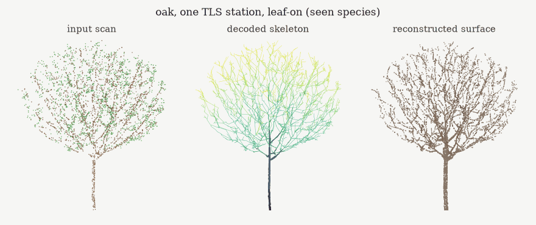
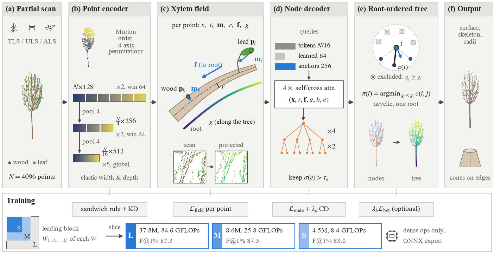
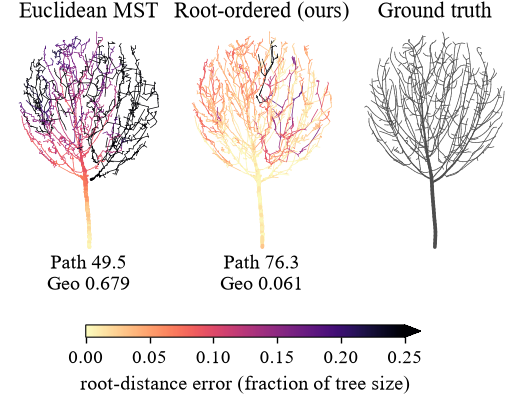
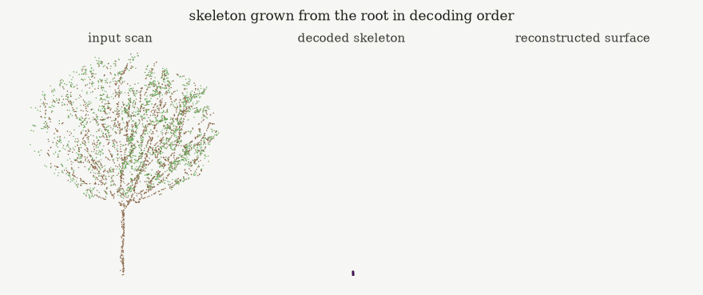
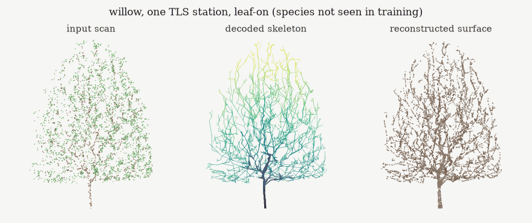
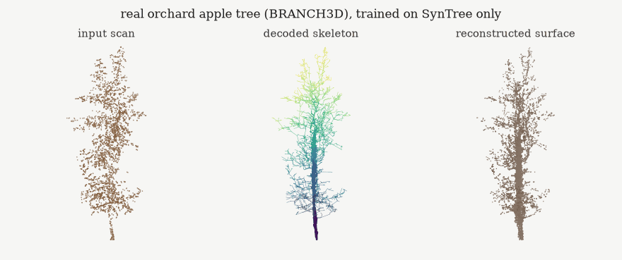
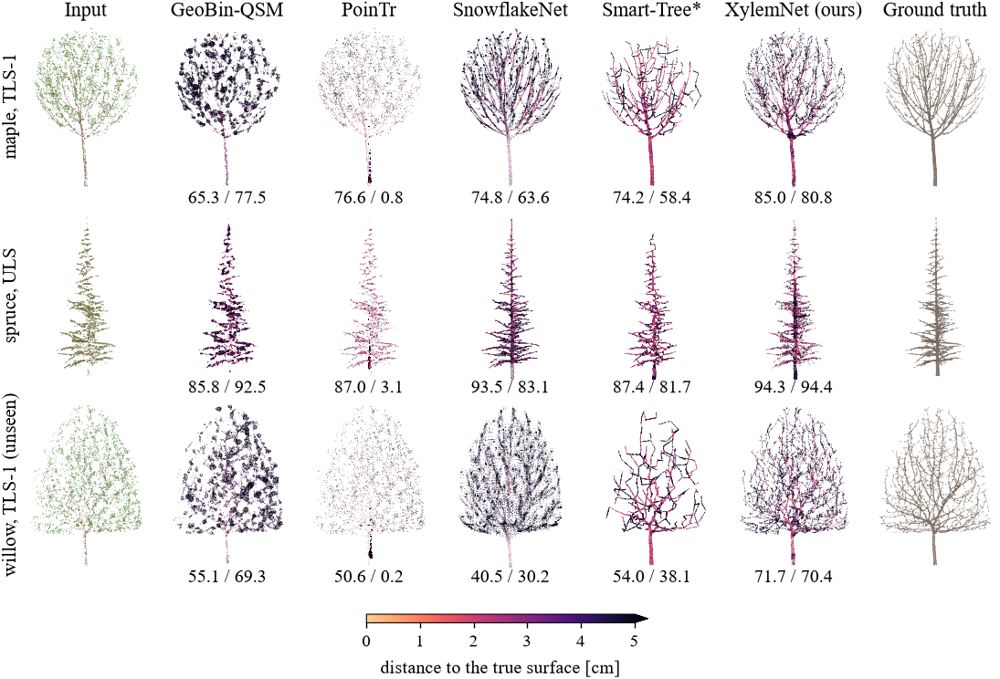
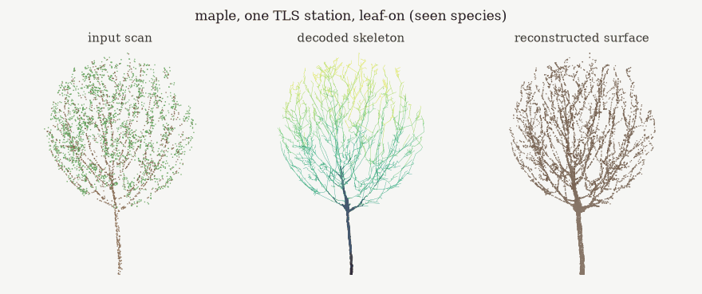

# XylemNet

Skeleton-first reconstruction of trees from partial laser scans.

<p align="center">
  
</p>

A single terrestrial scan sees one side of a crown, a UAV scan barely samples the stem, and leaves hide most twigs. XylemNet takes such a partial scan (4,096 points, 2,048 for the smallest model, leaves included) and returns three things that agree with each other: a rooted tree skeleton, a radius for every skeleton node, and the woody surface rendered on that skeleton.

The network predicts a *xylem field* for every input point: the offset to the axis of the branch that carries it, that branch's radius, the direction towards the root and the distance to the root along the tree. Leaf points are mapped onto the twig they hang on. These projected points, plus nodes added by a transformer decoder where the scan is empty, are connected by a root-ordered decoder that gives each node a parent closer to the root, so the output is always a single tree without cycles. In the animations, skeleton colour is that distance to the root.

The encoder is an elastic serialized point transformer. One supernet is trained once and sliced into three networks (L, M, S) whose outputs equal the corresponding supernet sub-networks.

## Method

<p align="center"></p>

The decoder choice matters more than any other part. With the same predicted nodes, a Euclidean minimum spanning tree joins neighbouring branches in the crown, and every node behind such a shortcut gets a wrong path to the root:

<p align="center"></p>

<p align="center"></p>

## Results

All numbers below come from the evaluation code in this repository (`xylem/metrics.py`) on the SynTree test sets and on BRANCH3D. F@1% and TBR are surface metrics (TBR is the recall of twig surface thinner than 1 cm), Sk-F is the skeleton F-score, Path is an APLS-style score that compares along-tree path lengths, and Geo is the error of the along-tree distance to the root. All learned baselines were re-implemented in plain PyTorch and trained on the same data for 40k steps with their official learning rate and weight decay; Smart-Tree\* uses our encoder.

SynTree, seen species (2,880 test scans: one TLS station, three TLS stations and UAV, with and without leaves):

| Method | F@1% ↑ | TBR ↑ | Sk-F ↑ | Path ↑ | Geo ↓ | Params |
|---|---|---|---|---|---|---|
| GeoBin-QSM (classical) | 78.7 | 74.7 | 84.0 | 64.2 | 0.418 | – |
| PoinTr | 75.3 | 73.6 | 39.2 | 39.4 | 0.445 | 42.9 M |
| SnowflakeNet | 78.4 | 71.7 | 70.2 | 64.1 | 0.363 | 19.6 M |
| SeedFormer | 78.5 | 72.0 | 70.8 | 63.2 | 0.400 | 19.0 M |
| Smart-Tree\* | 84.1 | 69.6 | 78.4 | 67.4 | 0.188 | 21.4 M |
| XylemNet-S | 82.9 | 75.9 | 79.5 | 62.7 | **0.090** | 4.5 M |
| XylemNet-M | **87.1** | 84.4 | **85.4** | 70.8 | 0.094 | 8.6 M |
| XylemNet-L | 87.0 | **84.7** | **85.4** | **71.1** | 0.094 | 37.8 M |

The paper's table also has PCN, FoldingNet, TopNet, GRNet, AdaPoinTr and PointAttN; none of them is best in any of these columns.

Willow and acacia are never seen in training (1,200 test scans). XylemNet-L reaches F@1% 86.9, TBR 82.9 and Path 75.4. GeoBin-QSM, which has nothing species-specific to learn, gets a slightly higher skeleton F-score there (87.0 against 85.3).

<p align="center"></p>

BRANCH3D (real orchard apple trees from DiffTS, 56 test scans of 54 trees, reference skeletons):

| | Sk-F ↑ | Path ↑ |
|---|---|---|
| GeoBin-QSM, trained on SynTree only | 28.0 | 20.1 |
| SnowflakeNet, trained on SynTree only | 22.2 | **30.3** |
| XylemNet-L, trained on SynTree only | **31.4** | 29.9 |
| Smart-Tree\*, fine-tuned on BRANCH3D | 35.7 | 28.8 |
| XylemNet-L, fine-tuned on BRANCH3D | **36.7** | **36.9** |

Without fine-tuning, GeoBin-QSM and SnowflakeNet are the strongest baselines on these two metrics; the other baselines are in the paper.

<p align="center"></p>

One supernet, three networks (SynTree seen species, F@1%):

| | Params | GFLOPs | sliced from the supernet | same architecture trained alone |
|---|---|---|---|---|
| L | 37.8 M | 84.6 | 87.3 | 87.8 |
| M | 8.6 M | 25.8 | 87.3 | 87.5 |
| S | 4.5 M | 8.4 | 83.0 | 82.9 |

<p align="center"></p>

<p align="center"></p>

The examples are not hand-picked. Each SynTree scan is the one whose XylemNet F-score is closest to the median of its species for that sensor and foliage setting; the BRANCH3D tree is the median scan by skeleton F-score.

### What does not work as well

- Smart-Tree\* reconstructs only the wood it sees, and it is more precise than XylemNet at thresholds of 1 to 5 cm (F@2cm 39.9 against 33.5) and on radii.
- On real forest trees (Weiser et al. 2022) no reconstruction method beats a breast-height circle fit when the stem is well sampled by a terrestrial scan. Reconstruction does give a stem diameter for every tree, including airborne scans where the circle fit works for 1.5% of the trees.
- The botanical regularizer (pipe-model band and parent consistency, weight `bot` in `xylem/losses.py`, 0.1 by default) does not help. In our ablation the model trained with `--loss_w '{"bot": 0}'` is better on every metric.
- Label-free adaptation to BRANCH3D (`--target branch3d`) with the original one-sided observation term let the decoder move most nodes far from the scan. With `--target_margin 0.1` the adaptation is stable and fits the observed wood better, but its skeleton is not better than zero-shot transfer (Sk-F 30.3 against 31.4).
- Our DiffTS re-implementation (`xylem/models/skel_baselines.py`) did not converge with this training protocol. Its numbers do not represent the published method.

## Installation

Python 3.9 or newer and a CUDA GPU. Install PyTorch for your CUDA version first, then:

```bash
pip install -r requirements.txt
```

Triton (shipped with the Linux PyTorch wheels) enables a fused nearest-neighbour kernel; without it a plain PyTorch fallback is used.

## Data

SynTree is generated procedurally, so nothing has to be downloaded for the main experiments:

```bash
python -m xylem.data.build_syntree --root data --budget full
```

This writes 12,000 training trees, 320 validation trees, 960 seen-species and 400 held-out-species test trees, the fixed test scans and the robustness sets to `data/syntree/`. Training scans are simulated on the fly.

External data (optional):

```bash
python tools/prepare_external.py --data data        # BRANCH3D (1.9 GB zip) and Synthetic-Trees (streamed and converted)
python tools/prepare_weiser.py --build_data data    # Weiser et al. 2022 single-tree clouds, fetched with HTTP range requests
```

Please follow the licences of BRANCH3D, Synthetic-Trees and the Weiser et al. data (PANGAEA 942856).

## Training and evaluation

Every experiment of the paper is a job in `xylem/experiments.py`. One command runs the whole study, schedules the jobs over all visible GPUs, resumes after interruptions and writes tables and figures to `results/report/`:

```bash
python run_all.py --list               # job graph (178 jobs) and the scheduler's GPU-hour estimate
python run_all.py --budget smoke       # tiny end-to-end check of every job
python run_all.py                      # full study
python run_all.py --only main,abl      # a subset of experiment groups
python run_others.py                   # rerun jobs that failed
```

Single steps, as `run_all.py` calls them:

```bash
# supernet (sandwich rule + in-place distillation), then search and slicing into L / M / S
python -m xylem.engine.train --exp main/xylem_supernet --method xylem --supernet --iters 60000 --bs 16 --lr 0.0005 --wd 0.05
python -m xylem.engine.search --exp main/xylem_supernet --n_random 300 --evo_gens 3 --evo_pop 30

# optional short fine-tuning of a sliced network
python -m xylem.engine.train --exp main/xylem_L_ft --method xylem --iters 5000 --warmup 250 --lr 0.0001 --bot_start 0.0 \
    --fixed_cfg @results/main/xylem_supernet/subnets.json:L --init results/main/xylem_supernet_L/ckpt_best.pt

# evaluation (per-scan CSV + mean JSON in results/<exp>/eval/)
python -m xylem.engine.evaluate --exp main/xylem_L_ft --sets syn_seen,syn_unseen,branch3d_test

# a baseline, e.g. PoinTr with its official optimiser settings
python -m xylem.engine.train --exp main/pointr --method pointr --iters 40000 --lr 0.0005 --wd 0.0005
```

Trained checkpoints are not part of this repository.

## Renders and export

```bash
# the animations above (needs a trained experiment and the cached test scans)
python tools/render_gif.py --exp results/main/xylem_L_ft \
    --scan data/syntree/fixed/test_seen/tls1/oak_00119.npz --out assets/oak.gif
python tools/render_gif.py ... --mode grow

# ONNX export of the sliced networks, checked against PyTorch with onnxruntime
python deploy/export_onnx.py --all
```

The networks use only linear layers, attention, layer norm and 1-D convolutions, so the export needs no custom operators. `deploy/jetson_benchmark.py` builds a TensorRT engine from the ONNX file and times it; we have not measured it on a Jetson ourselves.

## Repository layout

```
run_all.py               job scheduler for the whole study
xylem/data/              procedural trees, virtual laser scanner, datasets, external data converters
xylem/models/            XylemNet, elastic layers, root-ordered decoding, baselines
xylem/engine/            training, evaluation, sub-network search, slicing, adaptation, benchmarks
xylem/losses.py          training objectives
xylem/metrics.py         surface, twig, skeleton, topology and forestry metrics
xylem/experiments.py     every experiment as a job
tools/                   data preparation, report generation, GIF rendering
deploy/                  ONNX export and TensorRT benchmark
```

## Citation

The paper is under review; a citation will be added here.
